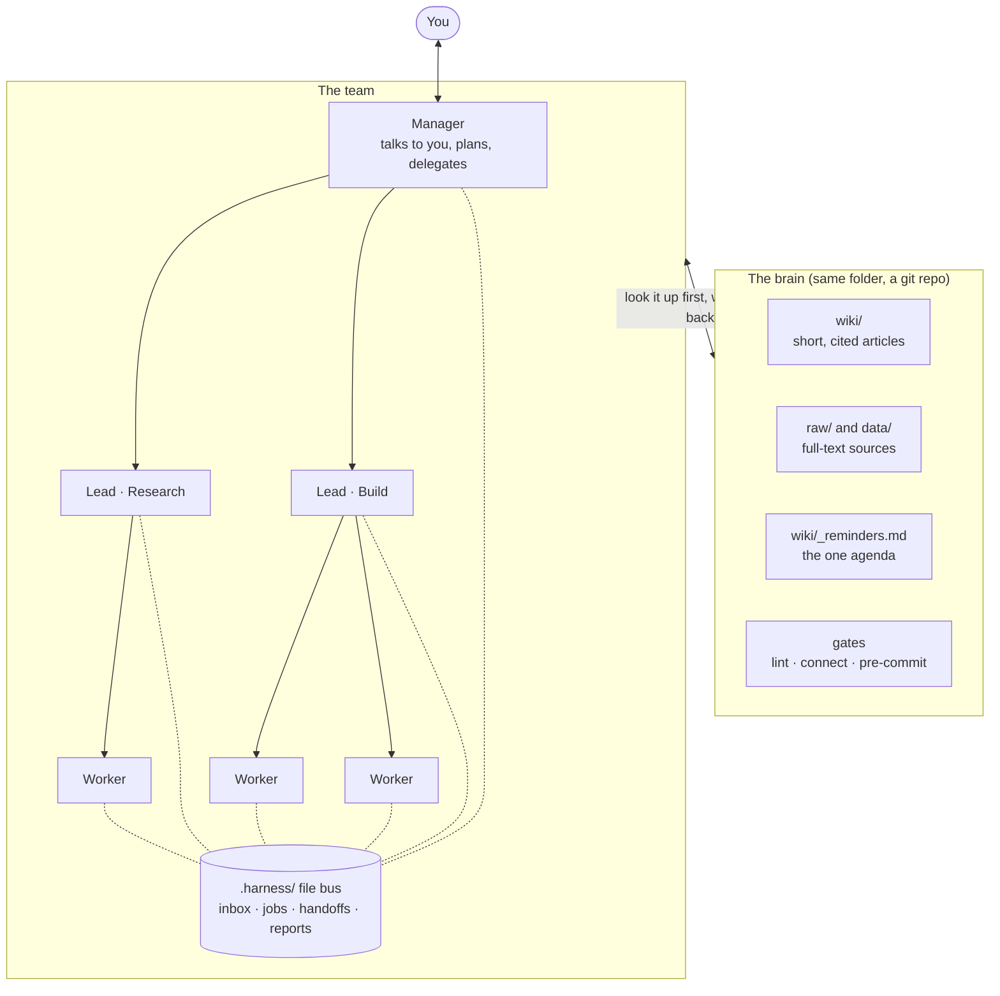

# agent-brain-harness

**A team of AI agents and a second brain they read first, in one folder, for any LLM app.**

[](https://github.com/NaluKicks-808/agent-brain-harness/actions/workflows/ci.yml)
[](LICENSE)

You talk to one Manager. It hands jobs to Leads, Leads hand them to Workers, and every one of them looks things up in a shared wiki before it asks you anything. The team talks through plain files, so it works with Claude Code, Codex, Gemini, VS Code, any terminal LLM, or a chat app where you carry the messages.

- Python 3.8 or newer, standard library only. Nothing else to install.
- Git, for the brain's commit gate and for the one-line installer.
- macOS, Linux and Windows.

## Contents

[How it works](#how-it-works) ·
[Quickstart](#60-second-quickstart) ·
[Use it with your app](#use-it-with-your-app) ·
[Features](#features) ·
[Daily loop](#the-daily-loop) ·
[Quality gates](#quality-gates) ·
[Configuration](#configuration) ·
[Commands](#commands) ·
[FAQ](#faq) ·
[Uninstall](#uninstall) ·
[Contributing](#contributing-and-tests) ·
[Credits](#credits)

## How it works



- **You** speak only to the **Manager**. It splits your request into jobs, one per department.
- A **Lead** owns a department. It turns a job into briefs, starts **Workers**, checks their proof and reports up.
- Roles never call each other directly. They write files in **`.harness/`**: an inbox per role, job briefs, handoffs for the next session, saved reports.
- The **brain** sits under all of them. Agents search it before asking you, and a new fact goes onto its wiki page in the same session.
- **Gates** refuse a commit while a link is broken or a fact is written on only one side. The rules live in scripts, not in anyone's memory.

The file rules are in [PROTOCOL.md](PROTOCOL.md). The role cards are in [core/roles/](core/roles/) and get copied into your project, where you can edit them.

## 60-second quickstart

Each installer finds Python, copies the program to `~/.agent-brain-harness/app`, creates your team and brain in `~/agent-brain`, and puts a `harness` command on your PATH. It asks only a few questions: the brain folder, the launcher, your PATH and the Claude Code hook. `--yes` takes every default. Add `--dry-run` to see every action first with nothing changed.

### macOS

```sh
curl -fsSL https://raw.githubusercontent.com/NaluKicks-808/agent-brain-harness/main/install.sh | sh
```

Or from a clone:

```sh
git clone https://github.com/NaluKicks-808/agent-brain-harness
cd agent-brain-harness
./install.sh
```

No Python 3.8 yet? Run `xcode-select --install` (it brings Python and git), then rerun.

### Linux

```sh
curl -fsSL https://raw.githubusercontent.com/NaluKicks-808/agent-brain-harness/main/install.sh | sh
```

Same clone route as macOS. No Python yet? `sudo apt install python3 git` (or `sudo dnf install python3 git`).

To pass flags through the pipe, put them after `sh -s --`:

```sh
curl -fsSL https://raw.githubusercontent.com/NaluKicks-808/agent-brain-harness/main/install.sh | sh -s -- --dry-run --yes
```

### Windows (PowerShell)

```powershell
irm https://raw.githubusercontent.com/NaluKicks-808/agent-brain-harness/main/install.ps1 | iex
```

Or from a clone:

```powershell
git clone https://github.com/NaluKicks-808/agent-brain-harness
cd agent-brain-harness
powershell -ExecutionPolicy Bypass -File .\install.ps1
```

Piped runs take flags from an environment variable, set first: `$env:AGENT_BRAIN_HARNESS_ARGS = '--dry-run --yes'`. No Python yet? `winget install --id Python.Python.3.12 -e` and `winget install --id Git.Git -e`. Git for Windows also brings the bash that `harness commit` uses. On Windows the launcher goes in `%USERPROFILE%\.agent-brain-harness\bin` and the installer adds that folder to your user PATH.

### What you'll see

Eight numbered steps, each line marked `ok`, `would` (dry run), `done` or `note`. An excerpt from a real macOS run (full transcript: [docs/install-transcript.txt](docs/install-transcript.txt)):

```text
agent-brain-harness installer
One setup: a Manager/Lead/Worker team plus a second brain they read first.

[1/8] Detect your system
      ok  os: Darwin 25.2.0 (arm64)
      ok  python: 3.9.6 at /usr/bin/python3
      ...

[2/8] Check what is installed
      ok  git: /usr/bin/git
      ok  claude (optional): /usr/local/bin/claude
      note  gemini not found (optional). Gemini CLI: npm install -g @google/gemini-cli
      ...

[5/8] Create the team and the second brain
      | brain: 39 files created; commit gate: installed at /Users/you/agent-brain/.git/hooks/pre-commit
      done  created the team (.harness/) and the brain in /Users/you/agent-brain
      ...

[7/8] Put the launcher on your PATH
      done  created launcher /Users/you/.local/bin/harness
      done  added a marked PATH block to /Users/you/.zshrc (open a new terminal to use it)
      ...

You're set. Next 3 things:
  1. Start the Manager:      cd "/Users/you/agent-brain" && /Users/you/.local/bin/agent-brain-harness launch manager
```

Run it again and it says `Nothing to do: already installed and up to date.`

### Start your Manager

Open a new terminal (so the PATH change applies), then:

```sh
cd ~/agent-brain
harness launch manager
```

That starts Claude Code, the default app. For another app, see the next section. `harness` and `agent-brain-harness` are the same command.

## Use it with your app

Every app reads the same two things first: `CLAUDE.md` (the brain's constitution) and then its role card. The installer adds rules files for the apps it finds on your PATH. To add one later, run `harness init --app <name> --no-brain` in your brain folder: `--no-brain` adds only the app's files and leaves your wiki alone.

| App | Start the Manager | Its rules file |
|---|---|---|
| Claude Code | `harness launch manager` | `CLAUDE.md`. The postmortem skill goes to `.claude/skills/wtfhappened/`. Optional role hook: see [adapters/claude-code/](adapters/claude-code/README.md). |
| Codex CLI | `harness launch manager --app codex` | `AGENTS.md` |
| Gemini CLI | `harness launch manager --app gemini` | `GEMINI.md`. The Gemini flags are not verified yet; check `gemini --help` against `.harness/harness.json`. |
| VS Code, Cursor, Copilot | `harness launch manager --app print`, then paste the output into the chat panel | `.github/copilot-instructions.md`, `.cursor/rules/agent-brain-harness.mdc`, `.vscode/tasks.json` |
| Any terminal LLM (aider, llm, ollama) | add an entry to `.harness/harness.json`, then `harness launch manager --app <name>` | the `apps` entry in `.harness/harness.json`. See [adapters/terminal/](adapters/terminal/README.md). |
| Chat-only apps (Claude Desktop, ChatGPT) | `harness launch manager --app print`, paste it as your first message | paste [adapters/chat/project-instructions.md](adapters/chat/project-instructions.md) into the app's project instructions. You carry messages with `harness send`. |

Leads and Workers start the same way: `harness launch lead --dept build`, and a Lead runs `harness spawn worker --job <id> --brief <file>`. Add `--new-window` to open a Lead in its own terminal window.

## Features

- **A team with clear lanes.** Manager, Lead, Worker and Reviewer each have a role card: what to do, what not to do, how to report. Reports are at most 8 bullets and say what was tested and what was not.
- **A second brain.** `wiki/` holds short, cited, linked articles. `raw/entries/` and `data/` keep the full text of every source forever. `harness find` searches the summaries; `tools/deepfind.py` searches the full text when you need the exact words.
- **Gates.** A git `pre-commit` hook runs `tools/lint.py` (broken links, orphan pages, citations that land nowhere, bad ledger rows) and `tools/connect.py` (a page you named but never updated from its side). Either one refuses the commit.
- **A closing ritual.** `harness close` runs both gates and exits nonzero on failure. `harness commit "message" <files>` then commits only the files you name, through `tools/safe_commit.sh`, which also keeps several sessions from committing over each other.
- **Postmortems that install a fix.** When something goes wrong, the `wtfhappened` skill checks whether it happened before, finds the gap in the system, and puts in a fix that is enforced rather than remembered. `harness postmortem "title"` appends a numbered entry to `wiki/_postmortems.md`.
- **One agenda.** Everything you owe or asked to be reminded of goes in `wiki/_reminders.md`, keyed to a date, an event or a condition. `harness agenda` reads it live. Each BOOT file shows the open agenda to the agent that starts.
- **Any LLM app.** Apps are entries in `.harness/harness.json`: a command for interactive use, one for headless use, and whether the start file goes on standard input. The value `"print"` turns any chat app into a member of the team.

More on the brain's tools and ideas: the `README.md` that init writes into your brain folder explains every folder and every tool.

## The daily loop

1. **Ask the Manager** for an outcome, in plain words.
2. **It delegates.** The Manager writes a job brief in `.harness/jobs/` and messages a Lead. The Lead spawns Workers with their own briefs and write boundaries.
3. **Agents look first.** Each one runs `harness find <terms>` before asking. Questions for you come only through the Manager.
4. **Facts land the same session.** A new fact goes onto its wiki page. Anything you owe goes in `wiki/_reminders.md`. Session notes go in `.harness/handoffs/`.
5. **Close and commit.** `harness close`, then `harness commit "message" <files you edited>`. Reports flow back up: Worker to Lead to Manager to you.

## Quality gates

Three checks keep "done" honest. All are optional except the reviewer step, which is part of the Lead's role card.

### Reviewer: no "done" without a check

A Lead may not tell the Manager a job is done until a **Reviewer** has checked the claim against evidence. The Reviewer is a fresh session with no memory of the work (and it can run on a different model than the Worker). It reads the diff, runs the tests, or looks at the live result, and answers `PASS`, `FAIL` or `UNVERIFIED`.

```sh
harness spawn reviewer --job j1-review --brief .harness/jobs/j1-review.md
```

The brief says what is claimed, what the done condition is and where the evidence is. The Lead's summary to the Manager ends with `Reviewed by: <model>, <verdict>`. A `FAIL` goes back to the Worker; an `UNVERIFIED` is never reported as done. The role cards are `.harness/roles/reviewer.md` and the "Verify before you report done" section of `.harness/roles/lead.md`. The Reviewer is for any claim, not only code: a document, a message sent, a change made somewhere else.

### Pre-push gate

A git `pre-push` hook that runs your project's tests and `scripts/leak_scan.py`, and refuses the push if either fails. It also runs `evals/eval_gate.py check` when the project has an eval gate (below).

```sh
harness gate install ~/code/my-repo    # or: ./install.sh --gate ~/code/my-repo
harness gate status ~/code/my-repo
harness gate uninstall ~/code/my-repo
git push --no-verify                   # skip it once, on purpose
```

Which tests run: the one-line command in `.harness/gate-tests` if you wrote one, otherwise a guess (`tests/` runs `python -m unittest discover -s tests`, a `package.json` with a test script runs `npm test`, a Makefile `test:` target runs `make test`). The leak scan runs when `scripts/leak_scan.py` exists; point `AGENT_BRAIN_HARNESS_LEAK_PATTERNS` at a file outside the repo to add your own terms. A pre-push hook that is not ours is never overwritten. The installer asks first (default no), supports `--dry-run`, records the hook in its manifest, and `--uninstall` removes only hooks it installed. On Windows the hook runs under the `sh` that comes with Git for Windows.

### Eval gate

For anything that calls a model (a prompt, a role card, a judge), the gate keeps a change from landing without a fresh passing eval. The Lead role for it is `core/roles/eval-gate.md`: start it with `harness launch lead --dept eval-gate`.

```sh
harness eval-init                          # copies the kit into ./evals
python3 evals/eval_gate.py run summarizer  # run one suite, write evals/results/summarizer.json
python3 evals/eval_gate.py check           # offline; exit 1 = red
```

- `evals/paths.json` lists, per suite, the model-facing files it covers.
- `evals/<suite>/cases.jsonl` holds golden cases taken from real failures. Code checks (`contains`, `not_contains`, `regex`, `max_chars`) decide first; one optional judge rule per case is asked of `judge_cmd`.
- The gate is red when a covered file changed since the last run, a suite never ran, the score is 0 (or under `min_score`), or `daily_call_cap` model calls were passed. The cap is the spend limit.
- `model_cmd` and `judge_cmd` in `evals/config.json` are any command that reads a prompt on standard input and prints the answer, so any LLM app works.

### Doctor

```sh
harness doctor
```

Checks that Python is new enough and which apps are on PATH; the installer's launcher and program; `harness.json` (default app, one inbox per Lead); the role cards, including that your `lead.md` has the verify step; the hooks (`role_card_hook.py`, and whether the Claude Code SessionStart hook is wired); the brain gates (pre-commit hook installed, `tools/` present, `lint` passes); the pre-push gate; and the eval gate when there is one. Each problem prints a `FIX` line with the command that repairs it. Exit status is 1 when something needs fixing, 0 otherwise. CI runs it on every OS.

## Configuration

### `.harness/harness.json`

| Key | What it does |
|---|---|
| `apps.<name>.interactive` | Command list for a normal session. `{kickoff}` becomes `Read <BOOT.md> and follow it. You are <title>.` The value `"print"` prints BOOT.md instead. |
| `apps.<name>.headless` | Command list for a background run (Workers, `--headless`). |
| `apps.<name>.stdin` | `true` sends BOOT.md on standard input. `false` adds the kickoff line as the last argument. |
| `default_app` | The app used when you leave out `--app`. Ships as `claude`. |
| `team.leads` | The departments. Ships as `["research", "build"]`. Set at init with `--leads research,build`. |

Placeholders for command lists: `{kickoff}`, `{boot}` (path to BOOT.md), `{python}`, `{root}` (the program folder), `{workspace}` (the `.harness/` folder).

Headless agents need permission to run the `harness` command. Add your own permission flags to the app entry; the harness never turns safety checks off for you. A tested headless Claude Code entry:

```json
"headless": ["claude", "-p", "--model", "sonnet", "--allowedTools", "Bash(python3:*) Bash(bash:*) Read Write"]
```

### Installer flags

Use them with `./install.sh`, `.\install.ps1` or `install.py`.

| Flag | What it does |
|---|---|
| `--yes`, `-y` | No questions, take every default. |
| `--dry-run` | Print every action, change nothing. |
| `--dir PATH` | Brain folder. Default `~/agent-brain`. |
| `--bin PATH` | Launcher folder. Default `~/.local/bin` (Windows: `%USERPROFILE%\.agent-brain-harness\bin`). |
| `--no-path` | Install the launcher but never edit your PATH or shell rc file. |
| `--no-brain` | The team only, no second brain. |
| `--claude-hook` / `--no-claude-hook` | Add (or skip) the Claude Code SessionStart hook in `<brain>/.claude/settings.json`. It shows each agent its role card and does nothing in an ordinary session. Default when asked: no. |
| `--gate REPO` | Also install the pre-push gate in this git repo. Repeatable. Asked about when you give none and answer at a terminal. |
| `--uninstall` | Remove what the installer added. Keeps your brain. |
| `--source PATH` | Install from this checkout instead of the folder the script is in. |

The PATH block goes in `~/.zshrc` (zsh), `~/.bash_profile` (bash on macOS), `~/.bashrc` (bash on Linux) or `~/.profile` (any other shell), between `# >>> agent-brain-harness >>>` markers.

### Environment variables

| Variable | Read by | What it does |
|---|---|---|
| `HARNESS_DIR` | harness | Use this `.harness/` folder instead of searching up from the current folder. |
| `HARNESS_ROLE`, `HARNESS_TITLE`, `HARNESS_SLUG`, `HARNESS_PARENT`, `HARNESS_CMD` | agents, hook | Set by `harness launch` for each agent: its role, title (`Lead · Build`), slug (`lead-build`), who it reports to, and the exact harness command. `send` uses `HARNESS_SLUG` as the sender. |
| `AGENT_BRAIN_HARNESS_REPO`, `AGENT_BRAIN_HARNESS_REF` | install.sh, install.ps1 | Download from another repository or branch. Defaults: this repository, `main`. |
| `AGENT_BRAIN_HARNESS_ARGS` | install.ps1 | Installer flags for a piped `irm \| iex` run. |
| `NO_COLOR` | install.py | Turn off colored output. |

## Commands

`harness` below is the installed launcher. Without the installer, use `python3 harness.py` from a clone (`py harness.py` on Windows).

### Team

```sh
harness init ~/my-project              # team + brain in a new folder (--no-brain, --no-git, --app, --leads)
harness launch manager                 # start the Manager in the default app
harness launch lead --dept build       # start a Lead (--new-window for its own terminal)
harness spawn worker --job j1 --brief .harness/jobs/j1.md   # a Lead starts a Worker
harness boot manager                   # write BOOT.md and print its path, start nothing
harness send --to lead-build "job: j1, see .harness/jobs/j1.md"
harness inbox lead-build               # print unread messages, mark them read (--keep)
harness status                         # unread counts, jobs, last reports
harness spawn reviewer --job j1-review --brief .harness/jobs/j1-review.md   # a Lead starts a Reviewer
harness doctor                         # hooks, roles, config, brain gates; prints a fix for each problem
harness gate install [REPO]            # git pre-push gate: tests + leak scan (status, uninstall)
harness eval-init                      # copy the eval gate kit into ./evals
```

### Brain

```sh
harness find bike                      # search the wiki
harness agenda                         # what is still open in wiki/_reminders.md
harness close                          # closing ritual: lint + connect
harness commit "add notes" wiki/log.md # gated commit of the named files (--all for a whole-tree sweep)
harness postmortem "a fact went one way"   # numbered entry in wiki/_postmortems.md
```

Brain tools you can run directly from the brain folder, with `python3 tools/<name>.py`: `lint`, `connect`, `find`, `deepfind`, `agenda`, `critic` (where the brain is thin), `quote_check` (do quoted words appear in the cited source), `expire_rows`, `event_twin`, `brain_quiz` (a scored quiz of the brain; the only tool that calls a model).

## FAQ

**What does it cost?**
The harness is free and MIT licensed. Agents run on your own LLM app and its plan. Each agent is its own session, so a Manager, a Lead and two Workers use more of your allowance than one chat would.

**Which model does it use?**
Whatever your app is set to. To pick one per role, add the app's model flag to its entry in `.harness/harness.json`, as in the headless example above.

**Does it work offline?**
The harness and the brain tools make no network calls. The exceptions are the one-line installers (they download this repository with git), `harness commit` (it pushes only if your brain has a remote named `origin`), and `brain_quiz.py` (it calls the model command you give it). Your LLM app needs whatever connection it normally needs.

**Does it send my data anywhere?**
No. There is no telemetry and no account. Your files go only where your LLM app sends them.

**Can my brain stay private?**
Yes. The brain is a local git repository with no remote. Commits stay on your machine until you add a remote yourself. If you add one, make it a private repository.

**Does it work on Windows?**
Yes, with PowerShell 5.1 or newer, Python 3.8 or newer, and Git for Windows. The Windows installer, the PowerShell launcher and the brain tools run in CI on `windows-latest`. The `safe_commit.sh` tests are skipped on Windows because they need POSIX file locking.

**How do I add another LLM?**
Add an entry under `apps` in `.harness/harness.json` with an `interactive` command, a `headless` command and `stdin`. Then `harness launch manager --app <name>`. Examples for aider, llm and ollama are in [adapters/terminal/](adapters/terminal/README.md). If the app can only chat, use `"interactive": "print"`.

**Can I use only the team, or only the brain?**
The team alone: install with `--no-brain`, or `harness init --no-brain`. The brain alone: use [second-brain-kit](https://github.com/NaluKicks-808/second-brain-kit).

## Uninstall

```sh
python3 ~/.agent-brain-harness/app/install.py --uninstall
```

On Windows: `py -3 "$env:USERPROFILE\.agent-brain-harness\app\install.py" --uninstall`. From a clone, `./install.sh --uninstall` does the same. Add `--dry-run` to see the list first.

It reads the manifest the installer wrote and removes only what the installer added: the launchers, the PATH block, the Claude Code hook and the program. Your brain folder is kept unless you type its name to confirm deleting it.

## Contributing and tests

```sh
python3 -m unittest discover -s tests -v    # the harness and the installer
python3 scripts/leak_scan.py                # no personal data in tracked files
(cd brain/template/tools && python3 -m unittest discover -s tests)   # the brain tools, in place
python3 harness.py init /tmp/proj && cd /tmp/proj && python3 -m unittest discover -s tools/tests   # the brain tools
```

The tests use a fake LLM (`tests/mock_llm.py`) for a full Manager, Lead, Worker round trip: the Worker writes a wiki fact and an agenda row, the Lead runs `harness close`, and the test checks the gates still pass. CI runs all of this on Ubuntu (Python 3.9 and 3.12), macOS and Windows, plus an install, rerun and uninstall in a clean home folder, and a separate job runs the brain tool tests in place.

Issues and pull requests are welcome. Keep it standard library only, and keep every claim in this README true of the code.

Not covered by the unit tests: the PowerShell and `.cmd` launchers, and `--new-window` on Windows and Linux. CI or a manual run covers them.

## Credits

The brain half is derived from [second-brain-kit](https://github.com/NaluKicks-808/second-brain-kit). The template here differs in four small ways: `hooks/pre-commit` and `tools/safe_commit.sh` fall back to `python` or `py -3` where `python3` does not work; `tools/lint.py` exempts `.harness`, `.github`, `.cursor` and `.vscode` from its top-level folder README check; `tools/tests/test_safe_commit.py` copies the folder instead of calling `git ls-files`; one test fixture word changed.

## License

[MIT](LICENSE).
